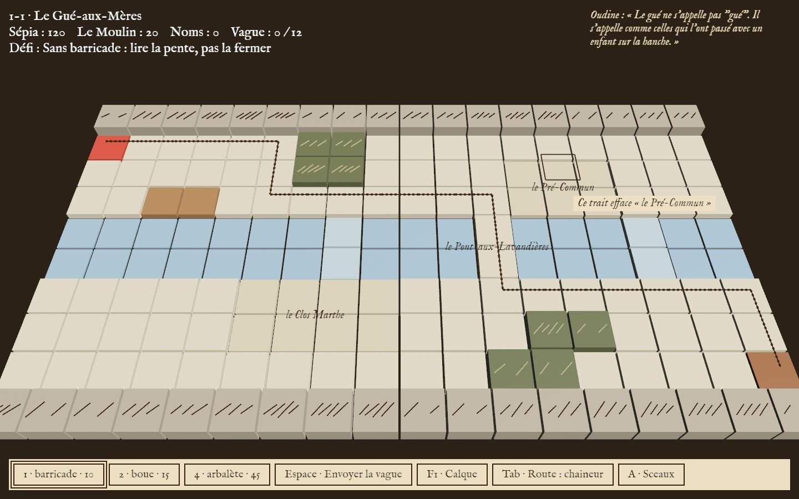
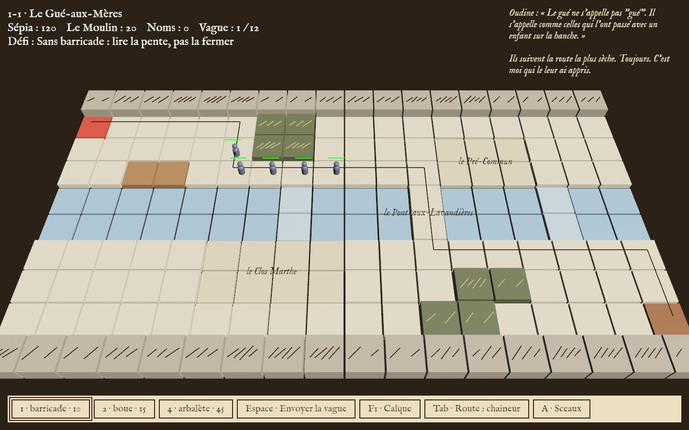
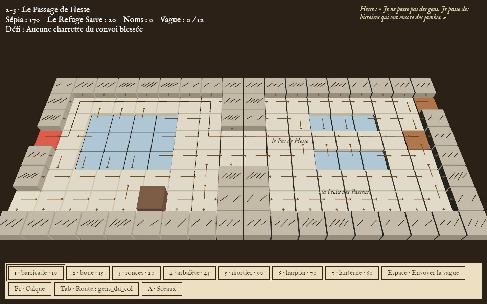

# Hachures

*Qui trace la frontière ?* — a cartographic tower defense.

Nève Achard, once the Empire's First Surveyor, has deserted before the Last Cadastre fixes the Marches for good. In
this world a map drawn in earth-ink, and seen by witnesses, becomes true. You don't stop the imperial columns with
walls of towers: you turn them aside by redrawing the relief, because every people reads the land its own way (by the
slope, by the shadow, by its goal). But every stroke has a price, a name scratched off the land. Under one rule: the
map may never be closed (*le Droit de Passage*).



A 3D low-poly tower defense built on path diversion, one Dijkstra flow field per species, written in Rust with
[Bevy](https://bevyengine.org) for the desktop and the browser.

| | |
|---|---|
|  |  |

## Play

- Each [GitHub release](../../releases) has desktop packages for Linux x86_64, macOS (Apple Silicon and
  Intel) and Windows x86_64. Unpack the archive and run `Hachures`; keep the `assets/` folder beside it.
- In the browser: unpack `Hachures-web.tar.gz` from the release on any static web server, or build the web
  version (below) and serve `website/`.
- From source: `cargo run --release -p game`. Asset paths are detected automatically for local runs and
  release archives.

The game is played with the mouse; the few keyboard shortcuts are on the *Controls* page. It is in French and
English (settings).

## Build

```sh
cargo run -p game --features dev     # desktop, fast incremental builds
cargo build --release -p game        # desktop release binary
cargo test -p game                   # tests, including the level and Droit de Passage checks
./scripts/build-web.sh               # browser build into website/play/
python3 scripts/check-web-package.py website/play  # package and HTTP smoke test
python3 -m http.server -d website    # then open http://localhost:8000/play/
```

The web build needs `rustup target add wasm32-unknown-unknown` and the `wasm-bindgen-cli` version that matches
`Cargo.lock`.

## Continuous delivery

Pull requests and code/assets changes to `main` run formatting, clippy, tests, the balance table, a WebAssembly
check, and parallel release builds on Linux, macOS, and Windows. Documentation-only changes are filtered out. Runs
cancel when a newer commit supersedes them, and Cargo dependencies and build outputs are cached.

Development uses `develop` as the integration branch. Work is done on short `feature/*`, `fix/*`, `docs/*`,
or `chore/*` branches and merged by pull request. A `release/vX.Y.Z` branch freezes a milestone for final
validation, then merges into `main` and is tagged. See [`CONTRIBUTING.md`](CONTRIBUTING.md) for the complete
workflow, branch protections, PR rules, and the `0.1.0` milestone process.

### Version `0.1.0`

`0.1.0` is the first technical playable release: the current Worlds 1–6 campaign, save/progression,
localization, CI/CD, native packages, and browser package. It is not the final game. Bonus sheets, the full
Signer editor, Heroic mode, complete ending consequences, Treuil branches, advanced audio, and the final art
pass remain documented limitations for later milestones. See the
[release document](docs/releases/v0.1.0.md) for its acceptance checklist and validation record.

Push a semantic version tag to publish desktop packages and a browser package:

```sh
git tag -a v0.1.0 -m "Hachures v0.1.0"
git push origin v0.1.0
```

The release assets are `Hachures-linux-x86_64.tar.gz`, `Hachures-macos-aarch64.tar.gz`,
`Hachures-macos-x86_64.tar.gz`, `Hachures-windows-x86_64.zip`, and `Hachures-web.tar.gz`.

## Contributing

Read [`CONTRIBUTING.md`](CONTRIBUTING.md) before opening a change. The local CI gate is:

```sh
./scripts/ci-local.sh
```

It runs the same formatting, lint, test, balance-regression, and WebAssembly checks as Linux CI. Pull requests
must describe the current state, intended change, regression coverage, and any platform or performance impact.

## Project overview

How the game and the code fit together, in a page: [`docs/project-overview.md`](docs/project-overview.md).

## Project

- `game/src/` — the game, one folder per feature; `game/assets/` — data, models, sounds, fonts, shaders, art.
- `docs/` — the design: `bible.md` (the game design and story, in French), `roadmap.md` (what is done and what
  comes next), the art direction and the 3D asset rules.
- `AGENTS.md` — the code rules (checked by CI) and the conventions; `docs/agents/map.md` — where everything lives.

## Licence

The code is dual-licensed under [MIT](LICENSE-MIT) or [Apache-2.0](LICENSE-APACHE), at your option. The assets keep
their own licences, listed in [`game/assets/CREDITS.md`](game/assets/CREDITS.md): Kenney models and sounds (CC0),
the music (CC0), the fonts (SIL OFL 1.1), and the 2D art (CC0).
